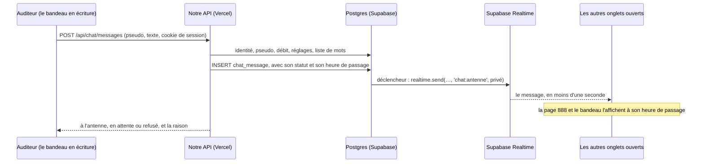

# Antenne libre — le chat en direct de Parabole Radio

Le chat de Parabole ne sera pas une boîte de plus dans un coin de l'écran : il passe **à l'antenne**. Les messages des
auditeurs défilent dans le **bandeau** du haut de chaque page, entre les phrases de Parabole ; on écrit **dans le
bandeau même**, son pseudo puis son message ; et toute la conversation se lit sur la **page 888**, une page de
télétexte qui s'ouvre à côté de l'image. L'équipe, « la régie », modère depuis l'admin, aidée de règles automatiques.

C'est le cahier des charges de l'antenne, et la description de ce qui est construit (branche `claude/antenne-libre`) :
le bandeau, l'écriture, la page 888, la modération par des règles, la diffusion en temps réel, l'écran de la régie. Pour
la mettre en ligne : section 6.7. Le document part de la pile du projet (`README.md`, `cms/README.md`) : Astro sur
Vercel, la base de Supabase, Drizzle, l'admin en React. Ce qui est dit de Supabase vient de sa documentation, en
novembre 2026, et d'essais sur un Supabase local.

**Décidé le 2 novembre 2026** : le chat quitte le panneau CHAT ; pas d'intelligence artificielle pour l'instant, la
modération automatique se fait par des règles ; les auditeurs ont une session anonyme, sans compte ; le pseudo se tape
juste avant le message. Ce qui reste à trancher est à la section 14.

**Sommaire**

1. [Ce qu'on veut](#1-ce-quon-veut)
2. [L'idée](#2-lidée)
3. [Ce que voit l'auditeur](#3-ce-que-voit-lauditeur)
4. [La modération automatique](#4-la-modération-automatique)
5. [La régie](#5-la-régie)
6. [Comment ça marche](#6-comment-ça-marche)
7. [Les données](#7-les-données)
8. [Qui peut quoi, et la sécurité](#8-qui-peut-quoi-et-la-sécurité)
9. [Les routes et les événements](#9-les-routes-et-les-événements)
10. [Données personnelles et cadre légal](#10-données-personnelles-et-cadre-légal)
11. [Quotas et coûts](#11-quotas-et-coûts)
12. [Les étapes](#12-les-étapes)
13. [Tests et recette](#13-tests-et-recette)
14. [Questions ouvertes](#14-questions-ouvertes)

---

## 1. Ce qu'on veut

- **Un chat qui fait partie du site**, pas une boîte de chat comme partout. Il parle la langue de la coque (le
  bandeau, les titres télé, le télétexte, la neige du zapping), et il se voit sur toutes les pages, même quand on ne
  fait qu'écouter.
- **Le temps réel** : un message arrive chez les autres en moins d'une seconde sur la page 888, et passe dans leur
  bandeau dans les secondes qui suivent.
- **Sans compte ni inscription** : un pseudo, tapé juste avant son premier message.
- **Une modération automatique par des règles** : insultes et propos haineux, harcèlement, coordonnées personnelles,
  liens, spam et flood. Pas d'IA pour l'instant.
- **La régie garde la main** : retirer un message, couper l'antenne de quelqu'un un moment ou le bannir, vider
  l'antenne, la fermer, la mettre en différé, régler le mode lent, traiter les signalements, tenir la liste des mots.
- **Le son ne se coupe jamais** : tout vit dans la coque, d'une page à l'autre.

Pas prévu : des comptes d'auditeurs (jamais), les messages privés, les images, les sondages, l'IA (pour l'instant), et
aucun son d'effet.

---

## 2. L'idée

Quatre références, toutes déjà dans l'esprit du site :

- **L'antenne libre.** À la radio, c'est le moment où l'on donne la parole aux auditeurs. C'est l'histoire des radios
  libres, que les clips du fond rappellent déjà (Radio Verte 1981, « Radio pirate mode d'emploi »). Ici, les auditeurs
  passent à l'antenne par écrit.
- **Le bandeau.** Il défile en haut de chaque page, « comme celui d'une chaîne d'info » (`src/styles/tete.css`). Il
  portera aussi les messages, comme les bandeaux où défilaient les dédicaces et les SMS des téléspectateurs sous les
  clips des chaînes musicales.
- **Le télétexte.** La conversation entière est une page de télétexte, la 888 : celle des sous-titres sur les chaînes
  françaises. Elle s'ouvre à côté de l'image, comme le télétexte en écran partagé des téléviseurs des années 90. La
  programmation en télétexte est déjà l'une des quatre touches télé retenues pour le site.
- **La régie.** L'équipe modère comme une régie de télévision. Un message retiré est « brouillé par la régie », comme
  les programmes cryptés de Canal+ ; une antenne fermée montre le carton « interruption momentanée », et la mire marque
  la fin des émissions : deux autres des quatre touches retenues.

**Où il se trouve.** En haut de l'écran, et plus en bas à droite : le panneau CHAT et sa touche dans la ligne du bas
disparaissent. Sur ordinateur, à l'accueil :

```
┌─────────────────────────────────────────────────────────────────┬────────────────────┐
│ BANDEAU : les messages défilent entre les phrases de Parabole   │ ▸ ANTENNE LIBRE    │
├─────────────────────────────────────────────────────────────────┴────────────────────┤
│ logo · menu                                                                 le son   │
│                                                                                      │
│  globe                                ┌─────────────────┐  ┌───────────────────┐     │
│                                       │ PAGE 888        │  │ PROGRAMMATION     │     │
│                 l'image               │                 │  │                   │     │
│                                       │ la conversation,│  │                   │     │
│                                       │ la plus récente │  └───────────────────┘     │
│                                       │ en haut         │                            │
│  ce qui passe                         │                 │                            │
│  ÉCOUTER                              │ ■ ■ ■ ■ fastext │                            │
│                                       └─────────────────┘                            │
│ réseaux · contributeurs · HISTORIQUE                                                 │
└──────────────────────────────────────────────────────────────────────────────────────┘
```

Trois endroits, un seul geste :

| | Où | Pour quoi |
|---|---|---|
| **Le bandeau** | En haut de toutes les pages | Lire : les derniers messages y défilent entre les phrases de Parabole |
| **Le bandeau en écriture** | Le même, transformé | Écrire : le pseudo, le message, ENVOI |
| **La page 888** | À côté de l'image : à gauche de PROGRAMMATION sur grand écran, à sa place sur un écran moyen, sur toute la place libre sur téléphone | Tout relire, répondre, signaler |

La case fixe au bout du bandeau, « ▸ ANTENNE LIBRE », avec la bulle de l'actuelle touche CHAT, ouvre l'écriture et la
page 888 ensemble. La refermer rend au bandeau son défilement.

---

## 3. Ce que voit l'auditeur

### 3.1 Le bandeau à l'antenne

```
┌──────────────────────────────────────────────────────────────────────┬─────────────────┐
│ ■ LUNE_NOIRE ▸ CE SON EST TROP LOURD ■ PARABOLE RADIO ■ KADER75 ▸ DÉD│ ▸ ANTENNE LIBRE │
└──────────────────────────────────────────────────────────────────────┴─────────────────┘
```

- **Les messages défilent entre les phrases de Parabole** (PARABOLE RADIO, CA VA PETER !!!…), séparés par le carré
  jaune. Une phrase revient tous les trois messages ; sans message depuis 30 minutes, le bandeau redevient celui
  d'aujourd'hui.
- **Un message** : le pseudo dans sa couleur, `▸`, puis le texte, en capitales blanches comme le reste du bandeau. Les
  couleurs de pseudo sont les sept du télétexte (rouge, vert, jaune, bleu, magenta, cyan, blanc), le bleu éclairci pour
  rester lisible sur le noir.
- **La régie** : à la place du pseudo, une case PARABOLE en bleu sur jaune. Ses messages passent avant les autres.
- **Son propre message** entre dans son bandeau dès l'envoi : on se voit passer à l'antenne.
- **Une mention** de son pseudo (`@lune_noire`) ressort en jaune.
- **La vitesse** reste celle d'aujourd'hui, environ 40 pixels par seconde : quand ça va vite, le bandeau ne passe pas
  tout. Il passe les plus récents et laisse filer les plus anciens, qui restent sur la page 888. Le bandeau n'est pas
  tout le chat : c'en est l'antenne.
- **Le survol** arrête le défilement, comme aujourd'hui ; un clic sur un message ouvre la page 888.
- **Un message brouillé** pendant qu'il passe se couvre de neige, puis de `▒▒▒`, et ne revient plus.
- **Avec « réduire les animations »**, le bandeau ne défile pas (c'est déjà le cas) : les messages s'y relaient sur
  place, un toutes les 6 secondes.
- **Pas de messages dans mon bandeau** : la touche jaune de la page 888 les en retire, dans ce navigateur. Le bandeau
  garde ses phrases.

### 3.2 Passer à l'antenne : le pseudo, puis le message

```
┌──────────────────────────────────────────────────────────────────────┬─────────────────┐
│ PSEUDO ▸ lune_noire   MESSAGE ▸ dédicace à tout le 18▌       [ENVOI] │ ANTENNE LIBRE ✕ │
└──────────────────────────────────────────────────────────────────────┴─────────────────┘
```

La case « ▸ ANTENNE LIBRE », ou un clic sur un message du bandeau, ouvre l'antenne : le bandeau s'arrête et devient la
ligne d'écriture, dans la même bande noire, et la page 888 s'ouvre à côté de l'image.

- **D'abord le pseudo** : la première fois, le champ PSEUDO est vide et prend la main ; Entrée passe au message.
  Ensuite, il est déjà rempli, et reste modifiable.
- **Puis le message** : 160 caractères au plus, comme un SMS ; le compteur apparaît à 140. Entrée envoie, comme la
  touche **ENVOI**, qui porte le nom de celle du Minitel.
- **ENVOI** reste éteint tant qu'il manque le pseudo ou le message.
- **La première fois**, une ligne rappelle : « En passant à l'antenne, tu acceptes les règles » (la touche rouge de la
  page 888). Turnstile, de Cloudflare, vérifie au même moment qu'on n'est pas un robot, le plus souvent sans rien
  demander ; s'il faut cliquer, sa case s'affiche en haut de la page 888.
- **Le pseudo** : 3 à 20 caractères (lettres, accents compris, chiffres, `_`, `-` et `.`), et une couleur tirée au
  hasard, à changer par la touche verte. On peut changer de pseudo à tout moment, trois fois par jour au plus ; un
  pseudo quitté reste réservé 7 jours à son ancien porteur.
- **Après l'envoi**, le champ se vide et le message arrive en haut de la page 888, en gris (« envoi… »), puis
  normalement. En attente : il reste gris, « en attente de la régie ». Refusé : son texte revient dans le champ, avec la
  raison : « La régie n'a pas passé ton message : pas de liens à l'antenne. »
- **Échap**, ou ✕ dans la case, referme l'antenne : la page 888 se range, le bandeau reprend.

### 3.3 La page 888

```
┌ P888  ANTENNE LIBRE ─────── EN DIRECT · 21:42:07 ┐
│ 21:42  KADER75      dédicace à tout le 18        │
│ 21:41  [PARABOLE]   tracklist dans 5 min !       │
│ 21:41  ▒▒▒▒▒▒ BROUILLÉ PAR LA RÉGIE ▒▒▒▒▒▒       │
│ 21:40  LUNE_NOIRE   ce son est trop lourd        │
│ 21:39  sam.b        @kader75 wesh                │
│                                                  │
├──────────────────────────────────────────────────┤
│ ■ RÈGLES   ■ PSEUDO   ■ BANDEAU   ■ FERMER       │
└──────────────────────────────────────────────────┘
```

Une page de télétexte, de la famille de PROGRAMMATION : le même cadre jaune qui bave, la même plaque sombre où l'image
passe encore, les lignes de balayage. Elle prend toute la hauteur libre, de l'en-tête à la ligne du bas, et s'allume en
clignant, comme le reste de la coque. Comme les autres panneaux, elle ferme HISTORIQUE en s'ouvrant, et inversement.

- **La ligne du haut** : `P888 ANTENNE LIBRE`, puis `EN DIRECT` ou `EN DIFFÉRÉ` (4.5), `MODE LENT · 10 S` s'il est mis,
  et l'horloge à la seconde, comme celle du télétexte. Sans signal, plus d'horloge : celle du télétexte venait du signal.
- **La conversation, la plus récente en haut** : les messages tombent du bandeau. Chaque ligne : l'heure, le pseudo
  dans sa couleur, le texte tel qu'il a été écrit, sans capitales forcées. Les 50 derniers.
- **Sur chaque message**, au survol, ou d'un appui sur téléphone : **SIGNALER**, **RÉPONDRE** (glisse `@pseudo` dans le
  champ du bandeau), **MASQUER** ce pseudo (dans ce navigateur seulement).
- **Un message brouillé** devient `▒▒▒ BROUILLÉ PAR LA RÉGIE ▒▒▒`, aux lignes décalées d'une image cryptée.
- **En bas, les quatre touches de couleur du télétexte** : **rouge**, les règles ; **vert**, le pseudo et sa couleur ;
  **jaune**, les messages dans le bandeau (oui ou non) ; **cyan**, fermer.

### 3.4 Les états, en mots de télé

| Situation | Le bandeau | La page 888 |
|---|---|---|
| Antenne fermée par la régie | Plus de nouveaux messages ; la case dit « ANTENNE FERMÉE » | Le carton « INTERRUPTION MOMENTANÉE » |
| Hors des horaires, si l'on en fixe (question 4) | Idem | La mire, et « REPRISE À 21 H » |
| Mode lent | — | `MODE LENT · 10 S` ; ENVOI compte les secondes |
| En différé | — | `EN DIFFÉRÉ` à la place de `EN DIRECT` |
| Exclusion | — | « Ton antenne est coupée jusqu'à 21 h 40 » |
| Bannissement | — | « Tu ne peux plus passer à l'antenne » |
| Connexion perdue | Les phrases de Parabole seules | « RECHERCHE DU SIGNAL… » sur un peu de neige ; les messages manqués arrivent au retour |
| Trop de monde connecté | Les phrases seules, sans message d'erreur | « ANTENNE SATURÉE, réessaie dans un moment » |
| Message en attente | — | En gris, « en attente de la régie » |
| Message refusé | — | « La régie n'a pas passé ton message : … » ; le texte revient dans le champ |
| Antenne vidée par la régie | Les messages partent dans la neige | De la neige, puis « LA RÉGIE A REMIS L'ANTENNE À ZÉRO » |

### 3.5 Sur téléphone

```
┌──────────────────────────┬───────────┐
│ ■ KADER75 ▸ DÉDICACE À T │ ▸ ANTENNE │
└──────────────────────────┴───────────┘
┌──────────────────────────────────────┐
│ TON PSEUDO ▸ lune_noire▌        [OK] │
└──────────────────────────────────────┘
┌──────────────────────────────────────┐
│ LUNE_NOIRE ▸ dédicace au 18▌ [ENVOI] │
└──────────────────────────────────────┘
```

- Le bandeau garde sa taille (34 px) ; sa case dit « ▸ ANTENNE ».
- L'écriture se fait en deux temps, dans le bandeau : d'abord « TON PSEUDO ▸ » et OK ; puis le pseudo devient une
  étiquette, suivie du champ du message et d'ENVOI. Toucher l'étiquette rouvre le pseudo.
- La page 888 prend toute la place libre, entre l'en-tête et la ligne du bas, comme une rubrique.
- Le champ est en haut de l'écran : le clavier, qui monte du bas, ne le cache jamais.

### 3.6 Accessibilité

- Le défilement du bandeau s'arrête au survol et au focus ; avec « réduire les animations », il ne défile pas ; la
  touche jaune en retire les messages.
- Les messages du bandeau ne sont pas lus par les lecteurs d'écran (`aria-hidden`) : le vrai fil est la page 888, une
  liste `role="log"`, et un lien caché, « Ouvrir l'antenne libre (le chat) », y mène au clavier.
- Les deux champs ont un libellé ; tout se fait au clavier ; les couleurs gardent un contraste de 4,5:1 sur le noir.

### 3.7 Les règles

Un texte court, sous la touche rouge, et rappelé à la première écriture. Une première version, à relire par l'équipe :

1. Ici on parle musique et on se respecte. Pas d'insultes envers les gens ; rien de raciste, sexiste, homophobe,
   transphobe ou validiste, rien sur la religion ou l'apparence de quelqu'un.
2. Pas de harcèlement ni de menaces, envers personne : auditeurs, résidents, invités, équipe.
3. Pas de coordonnées : ni les tiennes ni celles des autres (téléphone, adresse, e-mail, comptes privés).
4. Pas de pub ni de spam. Les liens se limitent aux plateformes de musique.
5. Ce que tu envoies passe à l'antenne : ton pseudo et ton message défilent dans le bandeau, sur toutes les pages, pour
   tous les visiteurs.
6. Une modération automatique filtre les messages ; la régie peut brouiller un message, couper ton antenne ou te bannir,
   sans préavis.
7. Un message te gêne ? « Signaler ».

---

## 4. La modération automatique

### 4.1 Le principe

Tout message passe par notre serveur avant d'exister pour les autres : le navigateur n'écrit rien en base et ne peut
rien diffuser sur le canal du chat (section 8). Le serveur vérifie dans l'ordre ci-dessous et s'arrête au premier refus.
Pas d'IA : des règles, la liste de mots de la régie, les signalements, et la régie elle-même. Quatre issues :

| Issue | Pour les autres | Pour l'auteur |
|---|---|---|
| **À l'antenne** | Le message passe, après le différé s'il y en a un | Il s'affiche normalement |
| **Masqué** | Il passe, les mots visés remplacés par `•••` | Idem |
| **En attente** | Rien, tant que la régie ne l'a pas passé | « en attente de la régie » |
| **Refusé** | Rien | La raison ; son texte revient dans le champ |

Chaque décision va au journal (section 5), avec qui l'a prise : les règles, la régie ou les signalements.

### 4.2 Les étapes

| # | Ce qui est vérifié | Si ça bloque | L'auteur lit |
|---|---|---|---|
| 1 | **L'identité** : une session valide ; ni exclusion ni bannissement en cours | Refusé | Sa situation (3.4) |
| 2 | **Le pseudo**, s'il est nouveau ou changé (4.3) ; Turnstile, la première fois | Refusé | « Ce pseudo est déjà pris », « Ce pseudo n'est pas possible »… |
| 3 | **L'état** : antenne ouverte ; mode lent respecté | Refusé | « L'antenne est fermée », ou le temps à attendre |
| 4 | **Le débit** : 5 messages par 30 s et par personne au plus ; 20 par minute et par adresse IP, tous pseudos confondus | Refusé | « Doucement : réessaie dans 12 s » |
| 5 | **La forme**, sur le texte nettoyé (espaces en trop, caractères invisibles, de contrôle et d'inversion du sens d'écriture retirés) : 1 à 160 caractères ; pas plus de 70 % de majuscules au-delà de 15 lettres ; 6 émojis, 3 mentions et 8 fois le même caractère de suite au plus ; pas la copie d'un de ses 3 derniers messages (2 minutes) | Refusé | « Trop de majuscules », « Message déjà envoyé »… |
| 6 | **Les liens** : refusés, sauf vers les domaines autorisés ; repérés même déguisés (« point com », espaces, `[.]`, raccourcisseurs d'adresses). Le bandeau n'en rend jamais un cliquable ; la page 888, seulement s'il est autorisé | Refusé | « Pas de liens à l'antenne » |
| 7 | **Les coordonnées** : numéros de téléphone (06 12 34 56 78, +33 6…, 0612345678), adresses e-mail | Refusé | « Pas de coordonnées à l'antenne » |
| 8 | **La liste de mots** de la régie (4.4) | Selon le mot : refusé, en attente ou masqué | « Propos interdits » |
| 9 | **Le mode prudent**, s'il est mis : les 2 premiers messages d'un nouveau pseudo attendent la régie | En attente | « en attente de la régie » |
| 10 | **Les sanctions automatiques** : 3 refus pour propos interdits ou coordonnées en 10 minutes coupent l'antenne de la personne pendant 10 minutes ; la deuxième fois dans la journée, pendant une heure | Exclusion | « Ton antenne est coupée jusqu'à … » |

Puis le **différé** (4.5), s'il est mis.

Tous ces nombres sont des réglages, rangés avec la modération (`cms/src/chat/`), pour les ajuster après les premières
émissions. Le navigateur fait les mêmes contrôles de forme pour prévenir tout de suite (le compteur, le mode lent), avec
le même code, mais seul le serveur décide.

### 4.3 Les pseudos

Un pseudo passe les étapes 5 à 8 (forme, liens, coordonnées, mots), et en plus :

- **les noms réservés** : Parabole, régie, admin, modo, modérateur, équipe, staff, radio… et le nom de chaque artiste
  publié dans le CMS (résidents et invités), pour que personne ne se fasse passer pour eux ;
- **les mélanges d'écritures** : un « а » cyrillique dans « Parabоle » est refusé ;
- **l'unicité** : comparés sans majuscules, sans accents et sans ces lettres trompeuses, deux pseudos ne peuvent pas
  être pareils.

Le pseudo s'attache à la session (6.3) : en changer ne lève ni une exclusion ni un bannissement.

### 4.4 La liste de mots

La régie la tient dans l'admin (écran Antenne libre, onglet Mots). Pour chaque entrée : le mot ou l'expression,
l'action (**refuser**, **mettre en attente** ou **masquer**) et une note.

La comparaison se fait sur une forme ramenée à l'essentiel : minuscules, sans accents, chiffres et symboles ramenés aux
lettres (`0`→o, `1`→i, `3`→e, `4`→a, `5`→s, `7`→t, `@`→a, `$`→s), lettres répétées réduites, séparateurs entre les
lettres retirés (« c.o.n.n.a.r.d »). Elle se fait **en mot entier** par défaut : « con » n'arrête ni « concert » ni
« conseil ». Une entrée peut aussi viser une suite de lettres où qu'elle soit, pour les injures qu'on soude à d'autres
mots.

La liste vise les injures haineuses et les insultes dirigées contre quelqu'un, pas les gros mots : « putain ce son est
lourd » doit passer. Ce qu'une liste ne voit pas, le sous-entendu ou le harcèlement sans gros mot, les signalements et
la régie l'attrapent.

La régie écrit la liste de départ et la saisit dans l'admin : le dépôt n'en garde que des mots d'essai, pour les tests.
Un champ « Tester un message » montre ce que la modération en ferait, étape par étape, sans rien publier.

### 4.5 Le différé

Comme à la télévision en direct, la régie peut mettre l'antenne **en différé** : 5, 10 ou 30 secondes entre l'envoi
d'un message et son passage chez les autres. Pendant ce temps, l'écran de la régie le montre avec son compte à rebours
et une touche **Couper** : un message coupé ne passe jamais. Son auteur, lui, le voit tout de suite, marqué « en
différé ».

C'est la protection d'un direct sensible, ou d'un chat qui s'emballe, quand quelqu'un de la régie surveille. Par
défaut : le direct.

Chaque message porte son heure de passage (`on_air_at`). Les navigateurs le reçoivent tout de suite, mais ne
l'affichent qu'à cette heure, et pas du tout si son retrait arrive avant ; l'historique ne rend que les messages déjà
passés. Un curieux qui fouille son navigateur peut lire un message quelques secondes avant les autres : le différé
empêche l'affichage, il ne garde pas de secret.

### 4.6 Les signalements

Toute personne qui a un pseudo peut signaler un message, avec un motif (propos haineux, harcèlement, coordonnées, spam,
autre). Le message va dans la file « À traiter » de l'admin. À partir de 3 signalements de personnes différentes (un
réglage), il est **brouillé pour tous** en attendant la régie. Pas plus de 10 signalements par heure et par personne.

---

## 5. La régie

### 5.1 L'écran Antenne libre

`/admin/antenne`, dans la rubrique « Site » de la barre latérale, à côté de « Vidéos de fond ». L'admin garde son style
d'outil, clair et sobre : ses actions portent des noms simples (Supprimer, Exclure), et la colonne du milieu du tableau
5.2 dit ce que les auditeurs en voient. Comme les autres écrans : rendu sur le serveur, en HTML au premier affichage, en
JSON quand l'application navigue ; chaque action part en `POST` à la même adresse, avec son `intent`, sur le modèle de
`src/pages/admin/videos.astro`.

- **En haut, les réglages**, toujours visibles : antenne **ouverte** ou **fermée** ; **mode lent** (désactivé, 3, 5, 10,
  30 ou 60 s) ; **différé** (direct, 5, 10 ou 30 s) ; **mode prudent** ; **messages au bandeau** (oui ou non : non, ils
  ne passent que sur la page 888) ; **liens** (aucun, plateformes de musique, tous) ; **Vider l'antenne**, avec
  confirmation.
- **L'onglet « En direct »** : les messages comme sur la page 888, avec ceux en attente et les signalés mis en
  évidence, ceux en différé avec leur compte à rebours, et le premier message d'un pseudo marqué « première fois ». Sur
  chaque message : **Supprimer** (avant son passage : **Couper**), **Exclure** (1 min, 10 min, 1 h, 24 h), **Bannir**,
  **Ses messages** ; sur un message en attente : **Publier** et **Rejeter**. En bas, un champ **Écrire en tant que
  Parabole** (lot 2).
- **L'onglet « À traiter »**, avec leur nombre : les messages en attente et les signalements, les plus anciens d'abord.
- **L'onglet « Personnes »** : les exclusions en cours et les bannissements, avec la raison, qui les a décidés, et
  **Lever**.
- **L'onglet « Mots »** : la liste (4.4) et « Tester un message ».
- **L'onglet « Journal »** : toutes les décisions, automatiques ou non, filtrables par message, par pseudo et par auteur
  de la décision.

L'écran redemande les nouveautés toutes les 2 secondes tant qu'il est visible, et s'arrête quand l'onglet est caché :
le navigateur de l'admin ne parle toujours pas à Supabase (section 6.6). La recherche de partout (⌘K) mène à l'écran.

Construits : les réglages, « En direct » (avec Écrire en tant que Parabole), « À traiter », « Personnes », « Mots ».
Pas encore : l'onglet « Journal » (le journal se remplit déjà, dans `chat_action`), « Tester un message », et le
compteur du tableau de bord.

### 5.2 Ce que fait chaque action

| Action, dans l'admin | Chez les auditeurs | En base |
|---|---|---|
| **Supprimer** | « brouillé par la régie », en moins d'une seconde, dans le bandeau comme sur la page 888 ; s'il est encore en différé, le message ne passe jamais | Le message passe à `removed`, avec qui et quand |
| **Exclure**, de 1 min à 24 h | « Ton antenne est coupée jusqu'à … » ; ses messages des 30 dernières minutes sont brouillés | `muted_until` sur l'auteur |
| **Bannir** | « Tu ne peux plus passer à l'antenne » ; ses messages des 30 dernières minutes sont brouillés ; un nouveau pseudo depuis la même adresse IP est refusé pendant 24 h | `banned_at`, la raison, qui |
| **Lever** | La personne peut écrire à nouveau | |
| **Vider l'antenne** | Les messages partent dans la neige ; « LA RÉGIE A REMIS L'ANTENNE À ZÉRO ». Les nouveaux venus ne voient que ce qui suit | `cleared_at` dans les réglages ; les messages restent, pour le journal |
| **Publier** un message en attente | Il passe à l'antenne, à l'heure de sa publication | `visible` |
| **Rejeter** un message en attente | Rien ; son auteur lit « La régie n'a pas passé ton message » | `refused` |
| **Fermer l'antenne** | Le carton « INTERRUPTION MOMENTANÉE » ; la case du bandeau dit « ANTENNE FERMÉE » | Les réglages |
| **Différé** | `EN DIFFÉRÉ` sur la page 888 ; les messages passent N secondes plus tard | Les réglages ; l'heure de passage de chaque message |
| **Messages au bandeau : non** | Le bandeau garde ses phrases ; le chat continue sur la page 888 | Les réglages |

Toutes les actions vont au journal, avec le membre de l'équipe qui les a faites.

### 5.3 Qui modère

Les admins et les éditeurs, comme pour les contenus (`cms/README.md`, 9.5). Les règles de la base décident, pas
l'écran : un bouton oublié ne donne aucun droit. Réserver certaines actions aux admins (la liste de mots, le différé) ne
demande qu'une migration (question 5).

---

## 6. Comment ça marche

### 6.1 Le chemin d'un message



### 6.2 Les choix

- **Supabase Realtime** pour le temps réel : il est déjà dans la pile et compris dans la formule ; une fonction
  Vercel, elle, ne garde pas de connexion ouverte.
- **Écrire passe par notre serveur** : la modération ne peut pas être contournée. Les tables du chat ne donnent aucun
  droit d'écriture au navigateur, et le canal ne lui permet pas de diffuser.
- **La base diffuse elle-même** (« Broadcast from Database ») : un déclencheur sur `chat_message` appelle
  `realtime.send()` au moment de l'écriture, avec un message dont on choisit la forme (ni adresse IP, ni identifiant
  interne). Une suppression devient un événement `retrait`, un vidage un événement `vidage`. Supabase envoie ainsi
  chaque message une fois à tous les abonnés, quand « Postgres Changes » vérifie chaque modification pour chaque
  abonné, un par un.
- **Un canal privé** : sur un canal public, n'importe qui ayant la clé publiable peut s'abonner et diffuser, dit la
  documentation de Supabase. On pourrait y publier de faux messages, case PARABOLE comprise, qui défileraient dans le
  bandeau de tous les visiteurs. Sur le canal privé, une règle autorise à recevoir ; aucune n'autorise à envoyer.
  Éteindre en plus **« Allow public access »** (Realtime → Settings) ferme les canaux publics : aucune autre partie du
  site n'utilise Realtime aujourd'hui, cela ne casse rien.

### 6.3 Les sessions anonymes

**Lire ne demande aucune session.** L'essai du lot 0 (le 2 novembre, sur un Supabase local avec Realtime) l'a montré :
un client qui n'a que la clé publiable rejoint le canal privé `chat:antenne` grâce à une règle `TO anon` sur
`realtime.messages`, et reçoit ce que la base y diffuse. Le faux message qu'il essaie d'y envoyer n'arrive chez
personne : aucune règle ne permet d'envoyer. Le bandeau se lit donc sur toutes les pages, pour tous les visiteurs, sans
rien leur ouvrir.

**Écrire passe par une session anonyme tenue par notre serveur**, et non par Supabase Auth : au premier message, le
serveur crée le pseudo et pose un jeton tiré au hasard dans un cookie `parabole_antenne` (un an, illisible en
JavaScript, réservé aux routes `/api/chat`, jamais envoyé par un autre site). La base n'en garde que l'empreinte. C'est
à ce pseudo que s'attachent le mode lent, les exclusions et les bannissements. Ni e-mail, ni mot de passe, et aucun
utilisateur anonyme à créer ni à purger chez Supabase : rien à régler dans Supabase Auth.

- **Les robots** : au premier message d'un pseudo, le serveur vérifie Turnstile (Cloudflare) lui-même. Sans réglages
  Turnstile, l'antenne marche sans cette vérification ; les limites de débit tiennent toujours.
- **Vider ses données de navigateur** fait perdre son pseudo : il faudra en choisir un autre (l'ancien reste réservé
  une semaine).

### 6.4 Dans le navigateur

- **Le chargement** : `@supabase/supabase-js` arrive à part, par un import dynamique : il ne ralentit ni le premier
  affichage ni le direct.
- **La connexion** reste ouverte tant que l'onglet est visible. Elle se ferme une minute après qu'il est caché (qui
  écoute dans un onglet de fond ne la garde pas), et se rouvre à son retour, avec l'historique. Cela ménage les 200
  connexions simultanées de la formule gratuite.
- **Lire sans rien perdre** : rejoindre le canal `chat:antenne` (`private: true`) et mettre de côté ce qui arrive ;
  demander l'historique à `GET /api/chat` (les 50 derniers messages passés à l'antenne depuis le dernier vidage, et
  l'état de l'antenne) ; fusionner les deux par identifiant. Après une coupure, supabase-js se reconnecte seul, et le
  chat refait de même.
- **Le bandeau** : `src/scripts/antenne.ts` prend la main sur `.bandeau-piste`. Il garde les phrases écrites par
  `TopBar.astro`, y glisse les messages, et fait défiler la piste lui-même, à la vitesse de l'animation CSS
  d'aujourd'hui, qu'il remplace. Une file d'attente : la régie d'abord, puis les plus récents ; au-delà de 5 messages
  en attente, les plus anciens sont laissés à la page 888.
- **La coque** : le bandeau et la page 888 ne sont jamais remplacés à la navigation ; ni la conversation ni la connexion
  ne se perdent d'une page à l'autre.

La « Broadcast replay » de Supabase pourrait rejouer les derniers messages au branchement, mais 25 au plus, et sans
tenir compte des retraits : l'historique passe donc par notre API.

### 6.5 Où est quoi

| Chemin | Rôle |
|---|---|
| `cms/src/schema.ts` | Les tables de l'antenne (section 7) |
| `cms/drizzle/0006_antenne.sql` | Écrite par drizzle-kit : les types, les tables, les index |
| `cms/drizzle/0007_antenne_acces.sql` | À la main : les règles d'accès et les droits, la trace des adresses IP, les déclencheurs de diffusion, la règle sur `realtime.messages`, la purge |
| `cms/src/chat/forme.ts` | Les contrôles du texte : nettoyage, forme, liens, coordonnées, liste de mots, pseudos. Sans base ni Node : aussi dans le navigateur, `@parabole/cms/antenne` |
| `cms/src/chat/index.ts` | `createAntenne()` : l'état, l'historique, l'envoi (le pseudo, puis la modération de la section 4.2), les signalements, la session anonyme. Avec la connexion du serveur |
| `cms/src/admin/chat.ts` | Les lectures et les actions de la régie, sous son rôle (`asMember`), branchées dans `createAdmin()` |
| `cms/src/local-supabase.ts` | Un faux `realtime` pour PGlite : le schéma, la table `messages`, `realtime.topic()`, et un `realtime.send()` qui note ce qu'il aurait diffusé |
| `cms/test/antenne.test.ts` | Les tests de l'antenne (section 13) |
| `src/pages/api/chat/`, `src/lib/antenne.ts` | Les routes du site (section 9) : le cookie de la session anonyme, l'adresse IP, Turnstile |
| `src/scripts/antenne.ts` | L'antenne à l'écran : la file du bandeau, l'écriture dans le bandeau, la page 888, les états, le texte des règles |
| `src/scripts/antenne-source.ts` | Ce qui relie l'antenne à sa source : les messages, l'état, les réponses, les sept couleurs |
| `src/scripts/antenne-supabase.ts` | La source : notre API pour l'historique et pour écrire, le canal Realtime pour ce qui passe, Turnstile au besoin |
| `src/styles/antenne.css` | Ses styles : le bandeau en écriture, la page 888, le brouillage |
| `src/components/TopBar.astro` | La case « ANTENNE LIBRE » au bout du bandeau, et la ligne d'écriture ; les phrases restent écrites ici |
| `src/components/Panels.astro`, `src/scripts/panels.ts` | Le balisage de la page 888 ; elle prend la place de PROGRAMMATION sur écran moyen, et ferme HISTORIQUE. L'ancien panneau CHAT ne sert plus qu'au secours |
| `src/scripts/settings.ts` | `CHAT` : `"antenne"`, `"radiocult"` (le panneau d'avant, en secours) ou `""` (pas de chat) |
| `src/pages/admin/antenne.astro`, `src/components/admin/AntenneScreen.tsx` | L'écran de la régie, ajouté à `AdminShell.tsx` (rubrique Site), au routeur (hors du cache des écrans : il change sans cesse) et à ⌘K |

### 6.6 Réglages et variables

| Où | Quoi |
|---|---|
| `astro.config.mjs` | `PUBLIC_SUPABASE_URL` et `PUBLIC_SUPABASE_PUBLISHABLE_KEY` sont en `context: "client"` : le bandeau en a besoin dans le navigateur. Elles ne sont pas secrètes. L'admin garde son fonctionnement : sa session en cookies `httpOnly`, et aucun client Supabase dans son navigateur |
| Vercel, et `.env` | `PUBLIC_TURNSTILE_SITE_KEY` (publique) et `TURNSTILE_SECRET_KEY` (secrète), facultatives |
| Supabase | Rien d'obligatoire. Database → Extensions : **pg_cron**, pour la purge de nuit (`cms/README.md`, 9.8). Realtime → Settings : éteindre **Allow public access** ajoute une barrière, si rien d'autre n'utilise de canal public |
| Cloudflare | Un widget Turnstile pour le domaine du site (et `localhost` pour le développement) |
| Vercel | La région des fonctions (Settings → Functions). La base est à Londres : si les fonctions tournent à Washington, la région par défaut de Vercel, chaque aller-retour vers la base traverse l'Atlantique. Les mettre à Londres ou à Paris |

### 6.7 Mettre en ligne

1. **Les migrations** `0006_antenne.sql` et `0007_antenne_acces.sql` sur la base de Supabase :
   `npm run db:migrate` depuis `cms/`, avec la chaîne Session pooler (`cms/README.md`, 4.4). Elles ne font qu'ajouter :
   le site d'aujourd'hui ne les voit pas. Sans elles, le bandeau garde ses phrases et la page 888 cherche le signal.
2. **Turnstile** (conseillé avant d'ouvrir au public) : un widget chez Cloudflare, puis ses deux clés dans Vercel.
3. **pg_cron**, pour la purge (`cms/README.md`, 9.8).
4. **La liste de mots de départ**, dans l'écran Antenne libre de l'admin, avant d'ouvrir.

Le réglage `CHAT = "radiocult"` de `src/scripts/settings.ts` remet le chat de Radio Cult en secours.

---

## 7. Les données

Six tables dans `public`, une dans `private`. Mêmes conventions que le reste du CMS (`cms/README.md`, section 2) :
identifiants en uuid, heures en `timestamptz`, `created_at` et `updated_at` tenus par Postgres, noms en anglais,
libellés français dans `labels.ts`.

| Table | Ce qu'elle garde | À savoir |
|---|---|---|
| `chat_author` | Une personne qui a choisi un pseudo : sa session anonyme | `token_hash` (l'empreinte du jeton de son cookie, unique), `pseudo` tel qu'affiché, `pseudo_key` (la forme comparée, unique), `color`, `last_seen_at`, `muted_until`, `banned_at`, `banned_reason`, `banned_by`. Les changements de pseudo se comptent au journal |
| `chat_message` | Un message, quelle que soit son issue | `author_id` (ou `member_id`, pour la régie), `pseudo` et `color` copiés à l'envoi, `body`, `status` (`visible`, `held`, `refused`, `removed`), `on_air_at` (l'heure de passage : l'envoi, plus le différé), `reason` (la raison lisible), `decided_by` (`rules`, `team`, `reports`), `removed_at`, `removed_by`. La catégorie d'un refus (`propos`, `coordonnees`, `liens`…) est au journal. Index sur (`status`, `on_air_at`) et (`author_id`, `created_at`) |
| `chat_report` | Un signalement | Le message, qui signale, le motif, quand ; traité par qui et quand. Un seul par personne et par message |
| `chat_term` | La liste de mots | Le mot, la comparaison (en mot entier ou partout), l'action (`refuse`, `hold`, `mask`), une note, qui l'a ajouté |
| `chat_action` | Le journal | Quand, qui (`rules`, `reports`, ou `team` et le membre), l'action, le message et l'auteur visés, le détail (`jsonb`) |
| `chat_settings` | Les réglages, sur une seule ligne | `open`, `slow_seconds`, `delay_seconds`, `careful` (le mode prudent), `ticker` (les messages au bandeau), `links` (`none`, `music` ou `all` ; les sites de musique sont écrits dans `cms/src/chat/forme.ts`), `report_threshold`, `cleared_at` |
| `private.chat_trace` | Pour chaque message : son identifiant, son auteur, l'adresse IP, la date | Hors de l'API de Supabase. La seule table qui garde une adresse IP (section 10) |

Les débits (étape 4) se comptent directement en base, sur les index de `chat_message` et de `private.chat_trace` : à
cette échelle, pas besoin d'un autre stockage.

---

## 8. Qui peut quoi, et la sécurité

### 8.1 Les droits

| | Lire l'antenne | Écrire un message | Diffuser sur le canal | Modérer, régler |
|---|:-:|:-:|:-:|:-:|
| Le public (clé publiable, rôle `anon`) | ✓ (canal privé, et notre API) | | | |
| Une session anonyme (le cookie `parabole_antenne`) | ✓ | par notre API seulement | | |
| Un éditeur, un admin | ✓ | en tant que Parabole | | ✓ |
| Le serveur (propriétaire des tables) | | après la modération | par les déclencheurs | |

- **Les tables de l'antenne** ont leur RLS, et des règles pour l'équipe seulement (`private.is_team_member()`), comme
  `background_clip`. Le public n'y a **aucun droit**, même en lecture : la clé publiable ne permet donc pas de les lire
  par l'API de Supabase. C'est une exception à « le site lit sous `anon` » : les routes de l'antenne lisent avec la
  connexion du serveur, comme le fera l'import Radio Cult (`cms/README.md`, 9.4), et ne rendent que des colonnes
  publiques.
- **Le canal** : une seule règle sur `realtime.messages`, en lecture :

  ```sql
  -- Recevoir l'antenne : tout le monde, avec la seule clé publiable, sur ce seul sujet. Aucune règle INSERT : aucun
  -- navigateur ne diffuse sur le canal ; seuls les déclencheurs de la base le font.
  CREATE POLICY chat_antenne_ecoute ON realtime.messages FOR SELECT TO anon, authenticated
    USING ((SELECT realtime.topic()) = 'chat:antenne' AND realtime.messages.extension = 'broadcast');
  ```

- **Les déclencheurs** qui appellent `realtime.send()` sont `SECURITY DEFINER`, avec `search_path = ''` : ils doivent
  aussi diffuser quand la régie modère sous son propre rôle.

### 8.2 Points de vigilance

- **Jamais de HTML** : un message s'écrit avec `textContent`, jamais `innerHTML`, dans le bandeau comme sur la page 888.
  Un lien autorisé ne devient cliquable que sur la page 888, construit à la main après la vérification de son domaine
  (`rel="nofollow ugc noopener noreferrer"`).
- **L'identité vient du cookie**, que le navigateur ne peut ni lire ni écrire en JavaScript, jamais d'un champ du
  message : le serveur en compare l'empreinte à `chat_author.token_hash`. Les routes qui écrivent refusent une requête
  venue d'un autre site (l'en-tête `Origin`).
- **Le serveur refait tout** : les contrôles du navigateur ne sont qu'un confort.
- **Aucun secret dans le navigateur** : la clé secrète de Turnstile reste sur le serveur.
- **Les journaux de Vercel** ne recopient ni le texte des messages ni les adresses IP.
- **`realtime.messages` a déjà sa RLS** : ne pas écrire `ALTER TABLE realtime.messages ENABLE ROW LEVEL SECURITY` dans
  une migration. Elle échouerait (`42501 must be owner of table messages`) et emporterait les règles qui suivent. Rien
  ne se crée non plus dans le schéma `realtime` sur Supabase : le faux `realtime` ne vit que dans `local-supabase.ts`,
  pour PGlite.
- **Les messages diffusés par la base** restent 3 jours dans `realtime.messages`, que Supabase vide seul.
  `realtime.send()` échoue, avec un simple avertissement, si aucun client ne s'est connecté de la journée : sans
  conséquence ici, puisque l'auteur d'un message est lui-même connecté.
- **Une règle simple** sur `realtime.messages` : sa complexité ralentit l'entrée dans le canal.

---

## 9. Les routes et les événements

| Route | Pour qui | Ce qu'elle fait | Cache |
|---|---|---|---|
| `GET /api/chat` | Tous | L'état de l'antenne (ouverte, mode lent, différé, bandeau, liens, le dernier vidage) et les 50 derniers messages passés à l'antenne depuis le dernier vidage | Aucun |
| `POST /api/chat/messages` | Tous | Envoyer : le pseudo et sa couleur (nouveaux ou changés), puis le message ; la modération décide. Au premier message, pose le cookie de la session. Rend `antenne`, `attente` ou `refuse`, la raison, et l'heure de passage. Le code `humain` demande Turnstile, le code `pseudo` un autre pseudo | — |
| `GET /api/chat/moi` | Une session | Son pseudo et sa couleur, une exclusion ou un bannissement en cours, l'état de ses derniers messages | Aucun |
| `POST /api/chat/signalements` | Une session avec un pseudo | Signaler un message | — |
| `/admin/antenne` | La régie | L'écran et ses actions (`intent`), derrière la garde de l'admin | Aucun (la garde) |

La session part dans le cookie `parabole_antenne`. Les réponses sont en JSON, et les raisons en français.

Les événements du canal `chat:antenne`, tous envoyés par la base :

| Événement | Contenu | Le site… |
|---|---|---|
| `message` | `id`, `pseudo`, `couleur`, `texte`, `regie` (la case PARABOLE), `heure`, `antenne` (l'heure de passage) | l'affiche à l'heure de passage, sur la page 888 et dans la file du bandeau |
| `retrait` | `id` | le brouille, ou ne l'affiche jamais s'il n'est pas encore passé |
| `vidage` | `heure` | envoie les messages dans la neige |
| `etat` | `ouvert`, `lent`, `differe`, `bandeau` | met la case, la page 888 et le champ à jour |

---

## 10. Données personnelles et cadre légal

**À faire relire par quelqu'un dont c'est le métier, avant l'ouverture.** Ce qui suit est un point de départ, pas un
avis juridique.

### 10.1 Ce qu'on garde, et combien de temps

| Donnée | Durée | Pourquoi |
|---|---|---|
| Les messages passés à l'antenne | 30 jours | L'historique ; la modération après coup |
| Les messages en attente, refusés, retirés | 30 jours | Revoir les décisions, régler les filtres |
| Le pseudo, la couleur, les sanctions | 1 an après la dernière activité | L'identifiant de l'auteur, à conserver ; les bannissements |
| L'adresse IP, la date et l'identifiant de chaque message (`private.chat_trace`) | 1 an | La conservation des données d'identification par les hébergeurs (LCEN, décret n° 2021-1362) |
| Les signalements | 30 jours | Ils partent avec le message signalé |
| Le journal | 1 an | La trace des décisions |

Une fonction `private.purge_chat()` fait tout cela ; pg_cron la lance chaque nuit sur Supabase, si l'extension est là
quand la migration passe (sinon : `cms/README.md`, 9.8). PGlite n'a pas pg_cron : la fonction s'y teste seule.

### 10.2 Ce qu'il faut dire aux auditeurs

- **Dans la politique de confidentialité** : les données du chat, leurs durées, et les prestataires : Supabase (la
  base, à Londres), Vercel et Cloudflare (Turnstile).
- **Dans les règles** (3.7) : que tout message passe à l'antenne, sur toutes les pages ; la modération, automatique et
  humaine ; le bouton « Signaler ».
- **Le stockage dans le navigateur** (le cookie de la session, posé au premier message ; le pseudo, les pseudos
  masqués, le choix du bandeau) ne sert qu'au service demandé : il entre dans l'exemption de consentement de la CNIL
  pour les traceurs strictement nécessaires. Turnstile : à vérifier.

### 10.3 Les textes

- **Le règlement européen sur les services numériques (DSA)** vaut pour les hébergeurs, même petits : un moyen simple
  de signaler un contenu illicite (le bouton « Signaler »), une explication à l'auteur dont le message est retiré ou
  refusé (la raison affichée), et des conditions qui décrivent la modération, outils automatiques compris (les règles).
  Les petites structures sont dispensées d'une partie des obligations des plateformes, pas de celles-ci : à confirmer.
- **La LCEN** : retirer promptement un contenu manifestement illicite qu'on nous signale ; conserver un an les données
  d'identification de qui publie (adresse IP, pseudo, date et heure).

---

## 11. Quotas et coûts

D'après les tarifs de Supabase, novembre 2026.

| Supabase Realtime | Gratuit | Pro (25 $ par mois) |
|---|---|---|
| Connexions simultanées | 200 | 500, puis 10 $ les 1 000 |
| Messages par mois | 2 millions | 5 millions, puis 2,50 $ le million |
| Messages par seconde | 100 | 500 |

Avec le bandeau, **chaque onglet visible** est connecté, et plus seulement ceux qui ouvrent le chat. Un message du chat
compte 1, plus 1 par onglet qui le reçoit : 3 000 messages par mois lus dans 60 onglets font environ 180 000 messages
Realtime, loin des 2 millions gratuits. Les connexions comptent davantage : au-delà de 200 onglets visibles en même
temps, les suivants ont un bandeau sans messages (ses phrases seules) et une page 888 « ANTENNE SATURÉE » ; le site et
le son continuent. D'où la connexion fermée quand l'onglet est caché (6.4), et la formule Pro le jour où l'audience
dépasse ce seuil. Pas de compteur de personnes connectées pour l'instant : Presence envoie un message à chaque onglet, à
chaque arrivée et à chaque départ.

Le reste ne coûte rien, ou presque : la base, les fonctions Vercel, Turnstile. Pas d'IA, donc pas de facture d'IA.

---

## 12. Les étapes

**Lot 0 — Vérifier** (fait le 2 novembre, en local)

- Le canal privé, la règle de réception : une règle `TO anon` suffit à un client sans session (6.3) ; un
  `channel.send()` depuis le navigateur n'arrive chez personne.
- Reste à faire : la région des fonctions Vercel ; le widget Turnstile (6.6).

**Lot 1 — Ouvrir l'antenne** (construit)

- Le modèle, les migrations, les règles d'accès, la purge, et leurs tests.
- La modération par les règles (4.2), le différé, le mode prudent, les signalements.
- Les routes, et la source branchée (`antenne-supabase.ts`) : le bandeau, l'écriture et la page 888. Le réglage
  `CHAT`, avec Radio Cult en secours.
- L'écran de la régie : les réglages, « En direct », « À traiter », « Personnes », « Mots ».
- Les règles, sur la page 888 (la touche rouge).
- Reste à faire : passer les migrations sur Supabase (6.7) ; la politique de confidentialité (10.2).

**Lot 2 — Le confort de la régie**

- Fait : écrire en tant que Parabole, avec la case PARABOLE dans le bandeau ; l'écran dans ⌘K.
- Reste : l'onglet Journal, « Tester un message », le compteur du tableau de bord.

**Lot 3 — Plus tard**

- Modérer directement depuis le site quand on est de la régie : les cookies de l'admin valent pour `/admin`, le site
  peut donc appeler `/admin/antenne` et ne montrer les boutons de modération qu'à l'équipe.
- Les phrases du bandeau tenues dans l'admin, pour y annoncer le programme (« CE SOIR 21 H : … »).
- Une ligne dans le texte micrographique de l'accueil (« ANTENNE LIBRE · 12 MESSAGES CE SOIR ») ; les dédicaces mises en
  avant dans le bandeau.
- Un mode « nouveaux pseudos » contre les raids (attendre 10 minutes avant d'écrire) et la détection d'un raid (le même
  message envoyé par plusieurs pseudos).
- L'écran de la régie en temps réel ; le nombre de personnes connectées.
- Une IA, si la régie n'y suffit plus.

---

## 13. Tests et recette

**Les tests automatiques** (Vitest, sur PGlite, comme le reste du CMS) : `cms/test/antenne.test.ts`, 24 tests.

- **les contrôles du texte** : mots déguisés (`c0nn4rd`, `c o n n a r d`, accents, caractères invisibles), faux
  positifs, liens déguisés, numéros de téléphone (pas les années), majuscules, émojis, répétitions, mentions, la liste
  de mots, la forme des pseudos ;
- **l'envoi** : la naissance d'un pseudo et la diffusion (le faux `realtime.send()` note ce qui aurait été diffusé),
  les pseudos pris, réservés ou d'artistes, trois changements par jour, les refus et les sanctions automatiques,
  l'attente et le masquage, l'antenne fermée, le mode lent, les débits par pseudo et par adresse, les doublons, le
  différé, le mode prudent, Turnstile au seul nouveau pseudo ;
- **les signalements** : le seuil qui brouille, et le retrait diffusé ;
- **la régie** : retirer, publier, rejeter, garder ; exclure et bannir (et l'adresse refusée 24 h) ; vider ; les
  réglages diffusés ; la liste de mots ; écrire en tant que Parabole ;
- **les règles d'accès** : le public et un compte hors de l'équipe ne lisent rien dans les tables de l'antenne ; la
  trace des adresses IP, et la purge.

Le test des migrations vérifie aussi la RLS de chaque table (`cms/test/migrations.test.ts`). Avec `TEST_DATABASE_URL`
(`cms/README.md`, section 8), les mêmes tests passent sur le vrai moteur de Supabase.

**La recette, à la main** (✓ : vérifié le 2 novembre, sur un Supabase local) :

| Essai | Attendu | |
|---|---|:-:|
| Deux navigateurs, un message | Il arrive en haut de la page 888 de l'autre en moins d'une seconde, et dans son bandeau dans les secondes qui suivent | ✓ (1,5 s au plus) |
| Le premier envoi | Le pseudo d'abord, puis le message ; ENVOI éteint tant qu'il en manque un | |
| Supprimer depuis l'admin | Brouillé partout en moins d'une seconde, bandeau compris ; l'admin le voit en 2 s au plus | ✓ |
| Fermer l'antenne depuis l'admin | « ANTENNE FERMÉE » au bout du bandeau, partout | ✓ |
| Différé de 10 s | L'autre navigateur le voit 10 s après ; coupé avant, jamais | |
| Depuis la console du navigateur, `channel.send()` sur `chat:antenne` | N'arrive chez personne | ✓ |
| Depuis la console, une lecture directe de `chat_message` avec la clé publiable | Refusée | ✓ (tests) |
| Le message `` | Affiché tel quel, en texte, dans le bandeau comme sur la page 888 | |
| Le survol du bandeau ; « réduire les animations » | Le défilement s'arrête ; sans animations, les messages se relaient sur place | |
| Couper le réseau 30 s | « RECHERCHE DU SIGNAL… », puis les messages manqués | |
| Changer de page | Le bandeau, la page 888 et la conversation restent | |
| Cacher l'onglet une minute, puis revenir | La connexion se ferme, puis se rouvre avec les derniers messages | |
| Sur téléphone | L'écriture en deux temps dans le bandeau ; le clavier ne cache pas le champ | |

---

## 14. Questions ouvertes

1. **Le nom** : « Antenne libre » (proposé), avec la case « ▸ ANTENNE LIBRE » au bout du bandeau ?
2. **Les messages au bandeau dès l'ouverture** (proposé), avec le différé et le mode prudent à la main de la régie ; ou
   d'abord sur la page 888 seulement ?
3. **Les messages retirés** : « brouillé par la régie » (proposé), ou une disparition sans trace ?
4. **Les horaires** : l'antenne ouverte tout le temps, ou seulement pendant les émissions en direct, avec la mire en
   dehors ?
5. **Qui modère** : les admins et les éditeurs (proposé), ou certaines actions aux admins seulement ?
6. **Les liens autorisés** au départ : soundcloud.com, bandcamp.com, hppr.fr, youtube.com, le site lui-même ?
7. **Les durées de conservation** (30 jours, 1 an) : à faire valider.
8. **La liste de mots de départ** : qui l'écrit ?
